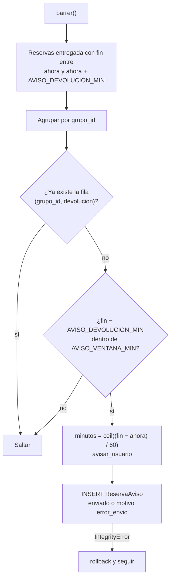

# Plan: aviso de devolución (30 min antes de `fin`)

Nuevo aviso automático de WhatsApp, cuarto tipo del barrido de
`flask-app/app/avisos_reservas.py`: cuando a una reserva **entregada** (el
estudiante ya tiene el equipo) le quedan 30 minutos, se le escribe para que
vaya a devolver. Ejemplo: reserva de 5 h → el aviso sale a las 4 h 30 min.

## Decisiones

- **Tipo:** `devolucion` (intent de auditoría `aviso_devolucion`).
- **Solo estado `entregada`.** Una reserva `confirmada` que nadie recogió ya
  pasa a `no_show` antes (a `min(inicio+30, fin)`), y a quien no tiene el
  equipo no se le pide devolverlo.
- **Momento:** `fin - AVISO_DEVOLUCION_MIN` (nueva config, default 30).
- **Frescura:** se envía solo si `fin - AVISO_DEVOLUCION_MIN <= ahora < fin`.
  Pasado `fin` ya no tiene sentido ("te quedan 30 min" sería falso; eso ya es
  `retrasada`), así que esas reservas ni se consultan: no se crean filas
  `vencido` para este tipo. (Ajuste posterior: también se exige que
  `fin - AVISO_DEVOLUCION_MIN` caiga dentro de `AVISO_VENTANA_MIN`, para que
  `AVISO_VENTANA_MIN=0` siga apagando todos los avisos.)
- **Minutos reales en el texto:** si recogió tarde (o el contenedor estuvo
  caído) y quedan menos de 30 min, el texto dice los minutos que de verdad
  quedan: `ceil((fin - ahora) / 60)`.
- **Mismo canal y mismas garantías:** `avisar_usuario` + fila en
  `reserva_avisos` con UNIQUE `(grupo_id, tipo)`, commit por aviso,
  `IntegrityError` → rollback y seguir. Sin hilo ni cron nuevo: lo corren el
  ticker y el barrido perezoso que ya existen.

## Cambios

1. **`postgres/init/02-schema.sql`**
   - En el `CREATE TABLE reserva_avisos`: `CHECK (tipo IN ('previo','hora','no_show','devolucion'))`
     y actualizar el comentario de la columna `tipo` y el bloque de comentarios
     de arriba (mencionar el cuarto aviso).
   - Al final del archivo, bloque idempotente `DO $$` (mismo patrón que
     `reservas_no_solapamiento`, ~línea 206): si `reserva_avisos_tipo_valido`
     existe y su `pg_get_constraintdef` **no** contiene `'devolucion'`, hacer
     `DROP` y volver a crearlo con los cuatro tipos.
   - Re-ejecutar contra la base viva (ver `docs/` / memoria de migraciones):
     `docker exec -e APP_DB_USER=<APP_DB_USER> -i lacs_postgres psql -v ON_ERROR_STOP=1 -U postgres -d <APP_DB_NAME> < postgres/init/02-schema.sql`
     (valores de `.env`).

2. **`flask-app/app/config.py`** y **`docker-compose.yml`**: `AVISO_DEVOLUCION_MIN`
   (default 30), junto a `AVISO_PREVIO_MIN`, con el mismo estilo.

3. **`flask-app/app/recursos_service.py`**: `mensaje_aviso_devolucion(reservas, minutos)`
   junto a `mensaje_no_show`, mismo estilo y helpers (`_nombres_con_cantidad`,
   `_formatear_hora`, `ZONA_HORARIA_LACS`). Texto:
   > ⏳ Te quedan {minutos} minutos de tu reserva N.º {grupo_id} ({activos}): termina a las {hora_fin}. Acércate a la LACS a devolver los equipos a tiempo.

4. **`flask-app/app/avisos_reservas.py`**
   - `AVISO_DEVOLUCION = "devolucion"`. **No** sumarlo a `_TIPOS_AVISO`: ese
     bucle es el del ciclo de no-show sobre reservas `confirmada`.
   - Nueva función `_barrer_devoluciones(ahora, cfg, conteos)` llamada al final
     de `barrer()` (mover el `if not lineas: return conteos` para que no la
     salte). Hace:
     - query `Reserva` con `joinedload(usuario, recurso)`, `estado == 'entregada'`,
       `fin > ahora`, `fin <= ahora + AVISO_DEVOLUCION_MIN`;
     - agrupa por `grupo_id`; una sola query a `ReservaAviso` con
       `tipo == AVISO_DEVOLUCION` para el lote;
     - por grupo sin fila: `fin_grupo = _con_tz(max(r.fin))`,
       `minutos = ceil((fin_grupo - ahora).total_seconds() / 60)`, manda con
       `avisar_usuario(usuario, texto, "aviso_devolucion")` (usuario `None` →
       no enviado), guarda `ReservaAviso(enviado, motivo=None|'error_envio')`,
       commit / `IntegrityError` → rollback;
     - suma a `conteos["grupos"]` y `conteos["avisos_enviados"]`.
   - Actualizar el docstring del módulo (cuatro avisos; el de devolución no
     cambia estado y no usa `vencido`).

5. **`flask-app/app/models.py`**: comentario de `ReservaAviso.tipo` y
   docstring con `'devolucion'`.

6. **`dashboard-frontend/src/features/metricas/MetricasPanel.tsx`**: etiqueta
   `aviso_devolucion: "Aviso de devolución"` junto a `aviso_no_show`.

7. **Docs:** en `docs/ARQUITECTURA.md` y `README.md`, donde se listan los
   avisos, sumar el de devolución (una línea cada uno, sin reescribir).

## Verificación (en Docker, nunca en el host)

- Reconstruir/reiniciar `flask-app` y el frontend con `docker compose`.
- Script `entregables/OE3/pruebas/verificar_aviso_devolucion.py`, estilo de
  `verificar_no_devuelto.py`, corrido con
  `docker exec -i lacs_flask_app python - < entregables/OE3/pruebas/verificar_aviso_devolucion.py`.
  Usa el usuario de pruebas `000000000000` (id 1; su envío falla solo, no le
  escribe a nadie; tarda ~10 s). **No llamar `barrer(ahora=<futuro>)`**: movería
  reservas reales de otros usuarios. Usar el reloj real:
  - A: grupo `entregada` con `inicio = now-1h`, `fin = now+20min` en un equipo
    libre → tras `barrer()` existe exactamente una fila `(gid, 'devolucion')` y
    una fila de `auditoria_bot` con intent `aviso_devolucion` cuyo texto dice
    "20 minutos" o "19 minutos". Segundo `barrer()` → sigue una sola fila.
  - B: grupo `entregada` con `fin = now+2h` → sin fila de devolución.
  - C: grupo `confirmada` con `fin = now+20min` sin entregar → sin fila de
    devolución.
  - Limpieza: borrar solo los grupos creados por la prueba (el historial de
    estados queda como evidencia, igual que en los otros `verificar_*.py`).
  - Si el ticker gana la carrera, la fila igual existe: comprobar por la tabla,
    no por los conteos que devuelve `barrer()`.
- `npm run build`/type-check del frontend dentro de su contenedor.

Sin commits.
