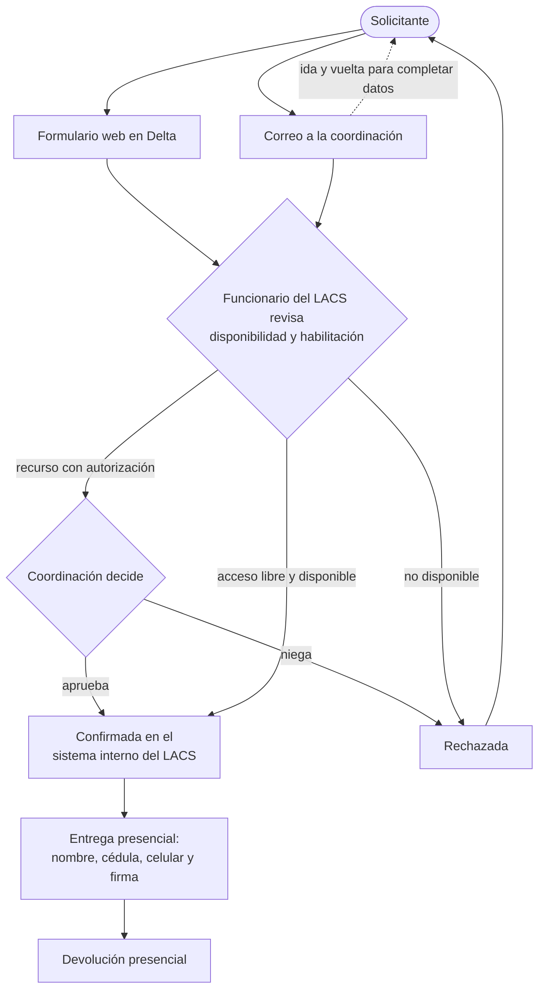

# Caracterización del proceso actual de préstamo y reserva del LACS

Entregable 3 del Objetivo Específico 1 (junto con [MODELO_DATOS.md](MODELO_DATOS.md)).

## 1. Actores

| Actor | Rol en el proceso |
|---|---|
| Solicitante | Estudiante, docente o trabajador de la Universidad que necesita un equipo o un espacio para un proyecto académico. |
| Funcionario del LACS | Revisa cada solicitud, verifica la disponibilidad y si el solicitante puede llevarse el recurso, y la confirma o la rechaza en el sistema interno del Laboratorio. |
| Coordinación del LACS | Decide sobre los recursos que, por su valor o especialidad, exigen autorización expresa. |
| Sistema Delta | Plataforma web institucional donde el solicitante registra su reserva. No está adaptada a dispositivos móviles. |
| Sistema interno del LACS | Plataforma de registro donde queda, de forma estructurada, quién reservó cada recurso y en qué fecha. |

## 2. Las dos vías de solicitud

Hoy el solicitante tiene dos vías. **Las dos desembocan en el mismo paso: un
funcionario confirma la solicitud en el sistema interno del LACS.** Ninguna de
las dos deja la reserva confirmada en el momento en que se pide.

### Vía 1: plataforma Delta (principal)

1. El solicitante entra a Delta desde un navegador, de preferencia en un computador.
2. Recorre los formularios: recurso, fecha y franja horaria.
3. La solicitud queda registrada en Delta como una petición, todavía sin confirmar.
4. Un funcionario del LACS la revisa: disponibilidad del recurso en esa franja
   y si el solicitante está habilitado para llevarlo.
5. El funcionario la confirma o la rechaza en el sistema interno del LACS.
6. Con la reserva confirmada, el solicitante se presenta en el Laboratorio a recogerla.

### Vía 2: correo electrónico (alterna, de uso poco frecuente)

1. El solicitante escribe a la coordinación del LACS indicando el recurso y la fecha.
2. Suele hacer falta un ida y vuelta de correos para completar datos básicos
   (franja horaria, propósito, datos del solicitante).
3. La solicitud pasa por **el mismo proceso que una de Delta**: un funcionario
   revisa la disponibilidad y la habilitación, y la confirma o la rechaza en el
   sistema interno del LACS.
4. La respuesta vuelve al solicitante por correo.

### Recursos de acceso libre y recursos con autorización

El catálogo tiene dos clases de recursos:

- **De acceso libre**: cualquier usuario habilitado puede llevarlos; la
  revisión del funcionario es solo de disponibilidad.
- **Con autorización expresa**: por su valor o especialidad, solo se entregan
  con el aval de la coordinación.

## 3. Entrega y devolución (presencial, fuera del alcance)

1. El solicitante se presenta en el Laboratorio.
2. Suministra su nombre, número de cédula y número de celular.
3. Firma el registro con el que el recurso queda a su nombre.
4. Al terminar el préstamo, devuelve el recurso en el Laboratorio.

Esta etapa exige la presencia física y la verificación documental del
responsable, por lo que **se conserva sin cambios**. El sistema nuevo solo
digitaliza el acta de esa entrega y de esa devolución (firma en pantalla o PDF
subido), sin reemplazar el acto presencial.

## 4. Diagrama del proceso actual



## 5. Problemas identificados

| # | Problema | Consecuencia |
|---|---|---|
| P1 | **Latencia entre la solicitud y la confirmación.** La disponibilidad no se verifica cuando el usuario pide, sino cuando un funcionario atiende la solicitud. | Ventana en la que varias solicitudes compiten por el mismo recurso sin que ninguna lo tenga apartado; incertidumbre para planear un rodaje. |
| P2 | **Cuello de botella humano.** Todas las solicitudes, incluso las de recursos de acceso libre, esperan la revisión de una persona en horario laboral. | Demoras y carga repetitiva para el personal. |
| P3 | **Canal ajeno al usuario.** Delta no está adaptado a móviles y el correo es asíncrono. | Obliga a usar un computador para una consulta de segundos; produce solicitudes incompletas. |
| P4 | **Seguimiento posterior manual.** La reserva queda registrada, pero ningún proceso la lee para avisar el vencimiento ni para registrar la devolución. | El recordatorio y la verificación del equipo dependen de la memoria del personal. |
| P5 | **Información dispersa.** Los datos del préstamo quedan almacenados pero desligados de la operación. | No hay informes en tiempo real de demanda, franjas de concurrencia ni desempeño del canal. |
| P6 | **Conocimiento informal.** El flujo de atención no está documentado y los practicantes rotan. | Criterios de atención no uniformes. |

## 6. Correspondencia con el sistema nuevo

| Paso o problema actual | Cómo lo resuelve el sistema |
|---|---|
| Formularios de Delta / correo (P3) | Conversación en lenguaje natural por WhatsApp. |
| Revisión de disponibilidad por el funcionario (P1, P2) | Consulta a PostgreSQL en el momento; la reserva se escribe en una transacción atómica con la restricción `EXCLUDE` que impide solapamientos. |
| Recursos de acceso libre | Quedan `confirmada` sin intermediación (`recursos.requiere_confirmacion = false`). |
| Recursos con autorización | Quedan `pendiente`; aparecen en el dashboard (Hoy → *Por confirmar*), la LACS confirma o deniega y el bot le avisa al solicitante. La decisión sigue siendo humana. |
| Confirmación en el sistema interno | El back office cumple ese papel para las reservas del sistema nuevo (calendario, reservas, activos, usuarios). No está integrado con el sistema interno actual. |
| Entrega y devolución presencial | Sin cambios. Se agrega el acta digital (firma en pantalla o PDF) que mueve la reserva a `entregada` y luego a `completada`, `devuelta_tarde` o `no_devuelta`. |
| Seguimiento manual (P4) | Avisos automáticos: antes de la recogida, a la hora, al no presentarse y antes del vencimiento de la devolución. No-show automático. |
| Información dispersa (P5) | Módulo de métricas en tiempo real y exportación a Excel. |
| Conocimiento informal (P6) | Flujo codificado en el bot y documentado en `docs/ARQUITECTURA.md`. |

## 7. Estados de una reserva en el sistema nuevo

```
pendiente ──(LACS confirma)──> confirmada ──(acta de entrega)──> entregada ──(acta de devolución)──> completada
    │                              │                                               ├─> devuelta_tarde
    └─(LACS deniega)──> denegada   ├─(sin recoger, automático)──> no_show          └─> no_devuelta
                                   └─(usuario o LACS)──> cancelada
```

Cada transición queda registrada por un trigger en `reserva_estado_historial`,
lo que permite reconstruir la historia de cualquier préstamo.
