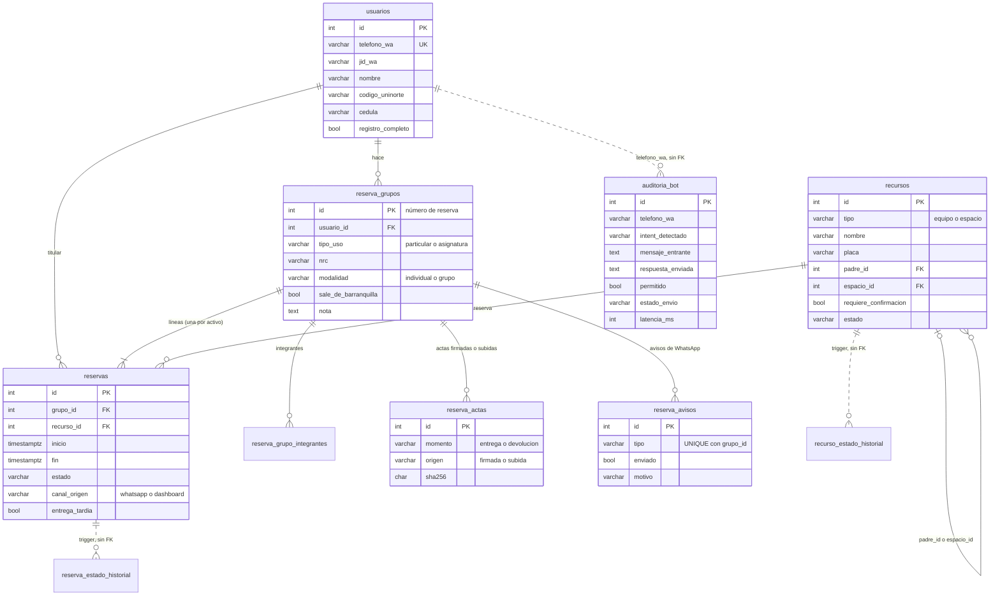

# Modelo de datos relacional

Entregable 3 del Objetivo Específico 1. El esquema completo está en
`postgres/init/02-schema.sql`; la explicación de cada decisión, en
`docs/ARQUITECTURA.md`.

## Diagrama entidad-relación

Las líneas punteadas no son llaves foráneas: los historiales los llena un
trigger sin FK, y `auditoria_bot` se cruza con `usuarios` por el número de
teléfono.



## Tablas

| Tabla | Qué guarda |
|---|---|
| `usuarios` | Solicitantes. Se crean en el primer mensaje y completan nombre, código Uninorte, cédula y celular en el registro por WhatsApp. |
| `recursos` | Equipos y espacios. `requiere_confirmacion` separa los de acceso libre de los que exigen autorización. `padre_id` arma el árbol cámara → lentes; `espacio_id`, el contenido de un espacio. |
| `reserva_grupos` | La reserva como la ve el usuario (número de reserva): tipo de uso, NRC, modalidad, seguro, nota. |
| `reservas` | Una línea por recurso dentro del grupo, con su franja y su estado. |
| `reserva_grupo_integrantes` | Códigos de los integrantes cuando la reserva es de un grupo de personas. |
| `reserva_actas` | Versiones de las actas de entrega y devolución (PDF firmado en pantalla o subido), con su hash SHA-256. |
| `reserva_avisos` | Avisos automáticos de WhatsApp. `UNIQUE (grupo_id, tipo)` garantiza que no se repitan. |
| `reserva_estado_historial` | Cada cambio de estado de una reserva. Lo escribe un trigger, para todos los caminos (bot, dashboard, barrido). |
| `recurso_estado_historial` | Cada cambio de estado de un activo (disponible, en mantenimiento, no disponible, no devuelto). |
| `auditoria_bot` | Cada interacción del bot: mensaje, intención, respuesta, si un guardrail lo bloqueó, estado de entrega y latencia. |
| `calendario_reglas`, `fechas_excepcion` | Días de la semana bloqueados, festivos y fechas sueltas en que el bot no acepta reservas. |
| Vista `reserva_puntualidad` | Retraso de cada entrega y cada devolución respecto a la franja reservada, calculado desde el historial. |

## Reglas de integridad en la base

- **No solapamiento.** Restricción `reservas_no_solapamiento`:
  `EXCLUDE USING gist (recurso_id WITH =, tstzrange(inicio, fin) WITH &&)`
  sobre los estados que ocupan el recurso. Es la garantía real contra dos
  reservas simultáneas; la prueba `entregables/OE3/pruebas/verificar_concurrencia.py`
  lo demuestra.
- **Historial inmutable.** Los triggers de historial son `SECURITY DEFINER`; el
  usuario de la aplicación solo puede leer esas tablas.
- **Privilegio mínimo.** La aplicación se conecta con `reservas_user`
  (`postgres/init/01-init.sql`), sin permisos de superusuario.

## Versionado del esquema

El esquema y todos sus cambios están versionados en git (`git log --
postgres/init/02-schema.sql`: 32 commits desde el 12 de agosto de 2026). El
archivo es idempotente (`CREATE ... IF NOT EXISTS`, `ADD COLUMN IF NOT
EXISTS` y bloques `DO $$` que revisan el catálogo antes de actuar). Postgres
lo ejecuta al crear el volumen, y para migrar una base que ya existe se vuelve
a correr completo:

```bash
docker exec -e APP_DB_USER=reservas_user -i lacs_postgres \
  psql -v ON_ERROR_STOP=1 -U postgres -d reservas_db < postgres/init/02-schema.sql
```

Así una base nueva y una base migrada terminan con el mismo esquema, sin
depender de una herramienta de migraciones externa.
